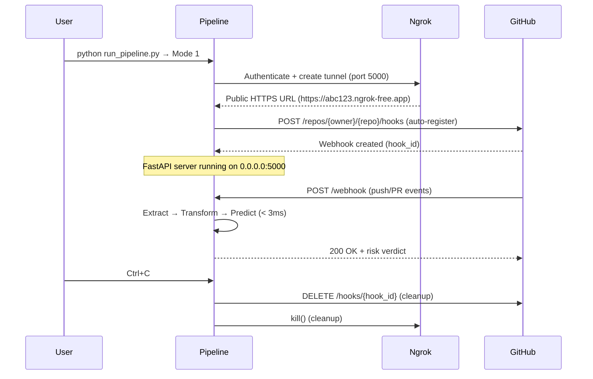

# AI-Powered CI/CD Failure Predictor — Module I (Metadata Risk Gatekeeper)
## Pre-Build Commit Metadata Risk Gatekeeper

> **A production-grade MLOps pipeline that predicts build failure risk from commit metadata before CI/CD execution begins.**
> **Context for AI Agents**: This is the *pre-build* metadata risk predictor (Module I), decoupled from the mid-build log classifier (Module II). It runs calibrated LightGBM inference on 38 commit/PR features (git churn, CI history, social metrics, repo characteristics) in **< 3 ms** to gate risk decisions before any build runner is provisioned.

---

## 🛑 1. Local Setup & Secrets (To Be Filled By You)

**⚠️ CRITICAL: This section must be completed before the pipeline runs. The `.env` file is gitignored and will never be committed.**

### Create `.env` at Repository Root
```bash
# F:\Capstone\Metadata Pipeline\.env
GITHUB_TOKEN=ghp_xxxxxxxxxxxxxxxxxxxx
NGROK_AUTHTOKEN=XXXXXXXXXXXXXXXXXXXXXXXXXXXXXXXXXXXXXXXXX
```

### `GITHUB_TOKEN` — Required for Both Modes
- **What**: A GitHub Personal Access Token (Classic) or Fine-Grained PAT
- **Required Scopes**:
  - `repo` (full control of private repositories) — **mandatory** for fetching commit metadata, PR details, and CI history via GitHub REST API
  - `admin:repo_hook` — **mandatory for Mode 1** to auto-register/delete webhooks on target repositories
- **Why**: 
  - Mode 1: Registers `push`/`pull_request` webhooks via `POST /repos/{owner}/{repo}/hooks`
  - Mode 2: Polls `GET /repos/{owner}/{repo}/commits` with `ETag/If-None-Match` (0 rate-limit cost on 304)
  - All feature extraction: `get_github_metadata()` calls `/repos/{owner}/{repo}/commits/{sha}`, `/pulls`, `/contributors`
- **How to Create**: GitHub → Settings → Developer Settings → Personal Access Tokens → Generate New Token (Classic)

### `NGROK_AUTHTOKEN` — Required for Mode 1 Only
- **What**: Your ngrok authentication token from [dashboard.ngrok.com](https://dashboard.ngrok.com/get-started/your-authtoken)
- **Why**: Authenticates the ngrok client to create a stable, authenticated HTTPS tunnel (`https://*.ngrok-free.app`) pointing to your local FastAPI server (default port 5000)
- **What Happens Without It**: Mode 1 falls back to unauthenticated tunnel (limited to 1 concurrent connection, 40 requests/minute, random subdomain per session)
- **Mode 2**: Does NOT require ngrok — runs entirely local with GitHub API polling

### Quick Verification
```bash
# Verify .env loads correctly
python -c "from dotenv import load_dotenv; import os; load_dotenv(); print('GITHUB_TOKEN:', 'SET' if os.getenv('GITHUB_TOKEN') else 'MISSING'); print('NGROK_AUTHTOKEN:', 'SET' if os.getenv('NGROK_AUTHTOKEN') else 'MISSING')"
```

---

## 🏗️ 2. Architecture & Optimization (Context for Teammate AIs)

### System Role in the Predictor Suite
```
┌─────────────────────────────────────────────────────────────────┐
│  AI-POWERED CI/CD FAILURE PREDICTOR — TWO-MODULE ARCHITECTURE  │
├─────────────────────────────────────────────────────────────────┤
│  MODULE I (THIS REPO) — PRE-BUILD METADATA RISK GATEKEEPER     │
│  • Input: Commit SHA + Repository URL                           │
│  • Features: 38 static/dynamic metadata features (no logs)     │
│  • Model: Calibrated LightGBM (1000 trees) + Platt Scaling     │
│  • Latency: ~3.4 ms p50, < 15 ms p95 SLA                       │
│  • Output: Failure probability + SHAP top-3 drivers + Verdict  │
│  • Modes: Webhook Listener (owned repos) / Passive Poller      │
├─────────────────────────────────────────────────────────────────┤
│  MODULE II (SEPARATE) — MID-BUILD LOG CLASSIFIER               │
│  • Input: Streaming build logs (stdout/stderr)                 │
│  • Model: Transformer/LSTM on log sequences                    │
│  • Output: Real-time failure classification during build       │
└─────────────────────────────────────────────────────────────────┘
```

### Persistent Repo Cache — The Key Optimization
**We DO NOT clone per commit.** Traditional pipelines `git clone --depth 50` → extract → `rm -rf` on every single commit. This repository uses a **persistent local Git cache** at `.repo_cache/{owner}__{repo}/`:

| Operation | Traditional (Per-Commit Clone) | This Pipeline (Persistent Cache) |
|-----------|-------------------------------|----------------------------------|
| **First Run** | `git clone --depth 50` (~15-30s) | `git clone` (full history, once) |
| **Subsequent Commits** | `git clone --depth 50` + fetch SHA (~15-30s) | `git fetch --all --prune` + checkout (~0.5-2s) |
| **Disk Usage** | Ephemeral temp dirs | Persistent `.repo_cache/` (shared across runs) |
| **Network** | Full clone every time | Incremental object delta only |

**Implementation**: `Metadata_Extractor/core/git_engine.py::sync_repo_cache()`
- **Path A (Cache Miss)**: Fresh clone into `.repo_cache/{owner}__{repo}/`
- **Path B (Cache Hit)**: `git fetch --all --prune` → checkout target SHA or `origin/HEAD`
- **Path C (Self-Healing Fallback)**: On any `git fetch`/`checkout` failure (corrupted index, force-pushed history, lock files), wipes cache via Windows-safe `_handle_remove_readonly` and retries Path A automatically

**Telemetry**: Every extraction prints exact timing:
```
[EXTRACT] Git sync completed in 0.42s (cache hit)
[EXTRACT] Feature extraction completed in 1.23s (cache hit)
```

### Model Artifacts (`Metadata Model/Models/run_20260926_013515/`)
| Artifact | Description |
|----------|-------------|
| `calibrated_metadata_model.joblib` | `CalibratedClassifierCV` (LightGBM + Platt Scaling) — **production model** |
| `base_lightgbm_model.joblib` | Raw `LGBMClassifier` (1000 trees, max_depth=12, num_leaves=127) |
| `shap_explainer.joblib` | `shap.TreeExplainer` for per-commit SHAP attribution |
| `scorecard.json` | Training metrics, feature importance, threshold matrix |
| `threshold_matrix_full.json` | Full precision/recall/F1 at every threshold |

**Training Data**: 919,833 deduplicated TravisTorrent build events (70/15/15 split)
**Target**: `y_fail = 1 - target_binary` (1 = FAIL, 0 = PASS)
**ROC-AUC (Calibrated)**: 0.8579 | **PR-AUC**: 0.7449

---

## 🔬 3. The 38-Feature Contract (Strict Column Order)

The pipeline enforces **exact 38-column schema** in `Metadata_Extractor/schema/columns.py`. No scaling math is duplicated in the normalizer — the extractor emits features already scaled.

### Feature Categories & Sources

| Category | Source Component | Key Features |
|----------|------------------|--------------|
| **Git Diff Churn** | `git_engine.py::get_churn_metrics()` | `git_diff_src_churn`, `git_diff_test_churn`, `total_files_changed`, `code_churn_density`, `test_to_src_churn_ratio`, `gh_diff_files_added/deleted/modified`, `gh_diff_tests_added/deleted`, `gh_diff_src_files`, `gh_diff_doc_files`, `gh_diff_other_files`, `gh_num_commits_on_files_touched` |
| **Repo Git History** | `git_engine.py::get_repo_git_metrics()` | `gh_repo_num_commits`, `gh_repo_age`, `git_branch`, `git_merged_with_present`, `gh_first_commit_created_at_year/month` |
| **Static Analysis** | `static_analyzer.py::analyze_workspace()` | `gh_sloc`, `gh_test_lines_per_kloc`, `gh_test_cases_per_kloc`, `gh_asserts_cases_per_kloc`, `gh_lang_java/python/ruby` |
| **GitHub Social/PR** | `github_api.py::get_github_metadata()` | `gh_is_pr`, `gh_num_issue_comments`, `gh_num_commit_comments`, `gh_num_pr_comments`, `log_team_size`, `gh_by_core_team_member`, `gh_pr_created_at_year/month`, `pr_dayofweek` |
| **CI History** | `ci_analyzer.py::get_ci_metrics()` | `tr_build_number`, `log_built_commits`, `git_prev_commit_resolution_status_merge_found`, `git_prev_commit_resolution_status_no_previous_build`, `has_previous_build` |

### Scaling Contracts (Enforced in Extraction Layer)
```python
log_team_size           = log1p(gh_team_size)
log_built_commits       = log1p(git_num_all_built_commits)
code_churn_density      = git_diff_src_churn / max(1, total_files_changed)
test_to_src_churn_ratio = git_diff_test_churn / max(1, git_diff_src_churn)
```

### Exact Column Order (38 Features)
```python
FEATURE_COLUMNS = [
    "gh_is_pr", "gh_lang_java", "gh_lang_python", "gh_lang_ruby",
    "git_prev_commit_resolution_status_merge_found",
    "git_prev_commit_resolution_status_no_previous_build",
    "gh_num_issue_comments", "gh_num_commit_comments", "gh_num_pr_comments",
    "log_team_size", "log_built_commits", "gh_repo_age", "gh_repo_num_commits",
    "tr_build_number", "gh_sloc", "git_diff_src_churn", "git_diff_test_churn",
    "gh_diff_files_added", "gh_diff_files_deleted", "gh_diff_files_modified",
    "gh_diff_tests_added", "gh_diff_tests_deleted", "gh_diff_src_files",
    "gh_diff_doc_files", "gh_diff_other_files", "gh_num_commits_on_files_touched",
    "gh_test_lines_per_kloc", "gh_test_cases_per_kloc", "gh_asserts_cases_per_kloc",
    "gh_by_core_team_member", "total_files_changed", "code_churn_density",
    "test_to_src_churn_ratio", "has_previous_build", "gh_pr_created_at_year",
    "gh_pr_created_at_month", "pr_dayofweek", "git_merged_with_present"
]
```

---

## ⚙️ 4. Operational Modes

### Prerequisites
```bash
pip install -r requirements.txt
# System deps: Git CLI, GitHub CLI (gh auth login)
```

### Run Pipeline
```bash
python run_pipeline.py
```

### Mode 1 — Webhook Listener (Zero-Click Automation)
**For repositories you own/administer.**



**What Happens Automatically**:
1. 🔐 Reads `NGROK_AUTHTOKEN` from `.env`
2. 🌐 Creates authenticated ngrok tunnel to `localhost:5000`
3. 🔗 Registers GitHub webhook (`push`, `pull_request` → `/webhook`)
4. 🚀 Starts FastAPI + Uvicorn server
5. 🧹 On shutdown: deletes webhook + kills ngrok tunnel

**Fallback**: If token lacks `admin:repo_hook`, prints manual setup instructions.

### Mode 2 — Passive Poller (ETag-Cached Radar Loop)
**For external/3rd-party repositories where you cannot install webhooks.**

```python
# Polling loop with ETag caching (in Inference_Engine/state_manager.py)
while not shutdown_requested:
    response = GET /repos/{owner}/{repo}/commits?per_page=1
              Headers: If-None-Match: <stored_etag>
    
    if 304 Not Modified:
        print(".")  # Silent heartbeat — 0 rate-limit cost
        sleep(interval)
        continue
    
    if new_sha != last_seen_sha:
        extract_features(new_sha)
        predict_risk()
        print_telemetry()
        last_seen_sha = new_sha
    
    sleep(interval)
```

**Rate-Limit Optimization**:
- `ETag` / `If-None-Match` headers → **304 responses cost 0 rate-limit points**
- `last_seen_sha` tracking → skips extraction when SHA unchanged
- Default 30s interval → ~2,880 checks/day (well within 5,000/hr limit)

**UX**: Silent `.` heartbeats during steady state; full telemetry only on new commits.

---

## 📊 5. Gating Thresholds & Output Format

### Production-Calibrated Thresholds

| Risk Score | Verdict | Action | Use Case |
|------------|---------|--------|----------|
| **< 0.25** | 🟢 **FAST-TRACK** | Proceed with standard/accelerated build | Low risk — 73% recall, 56% precision |
| **0.25 – 0.50** | 🟡 **STANDARD GATE** | Proceed with monitoring | Moderate risk — 51% recall, 78% precision |
| **0.50 – 0.65** | 🟠 **ALERT** | Flag PR/commit for review | Elevated risk — 47% recall, 81% precision |
| **> 0.65** | 🔴 **PRE-MERGE BLOCK** | Halt expensive runner / isolate build | High risk — 40% recall, 88% precision |

*Thresholds derived from calibrated sigmoid model on 137,975 test builds.*

### Telemetry Output (Per Commit — The "Card")

Every prediction emits a structured terminal card:

```
======================================================================
[INGEST]  Repo: myorg/myrepo | Branch: feature/login
          Commit: abc1234 (abc1234def5678...)
          Event: PUSH
          Time: 2026-10-19T14:32:11.456789

[EXTRACT] Files touched: 12
          Src churn: 342
          Test churn: 18
          Prev build: Yes
          Git sync: 0.42s (cache hit)
          Feature extraction: 1.23s (cache hit)

[TRANSFORM] All 38 features validated ✓ | Scaling contracts passed ✓

[INFERENCE] Calibrated Failure Probability: 23.45%
            Raw Score: 0.2345
            Model Latency: 3.421 ms

[SHAP TOP DRIVERS]
  Pushing risk UP:
    + git_diff_src_churn: +0.1823
    + total_files_changed: +0.1247
    + gh_diff_tests_deleted: +0.0891
  Pushing risk DOWN:
    - gh_test_lines_per_kloc: -0.1562
    - gh_by_core_team_member: -0.0984
    - log_built_commits: -0.0731

[VERDICT] 🟢 FAST-TRACK — LOW RISK — Proceed with standard/accelerated build
======================================================================
```

**Key Fields for Downstream Consumers**:
- `failure_probability_pct`: Calibrated probability (0-100)
- `raw_score`: Uncalibrated LightGBM output (for debugging)
- `latency_ms`: End-to-end model inference time
- `shap_drivers.positive/negative`: Top-3 risk drivers with signed SHAP values
- `verdict`: One of `FAST-TRACK`, `STANDARD GATE`, `ALERT`, `PRE-MERGE BLOCK`
- `features`: Full 38-feature dict for auditability

---

## 📁 6. Project Structure

```
F:\Capstone\Metadata Pipeline\
├── .env                          # Credentials (gitignored) — YOU CREATE THIS
├── .gitignore                    # Comprehensive ignore rules (includes .repo_cache/)
├── requirements.txt              # Unified dependencies
├── run_pipeline.py               # 🎯 Main CLI entrypoint (Mode 1 + Mode 2)
├── README.md                     # This file
│
├── Inference_Engine/             # 🧠 Live inference pipeline
│   ├── __init__.py
│   ├── predictor_service.py      # Model loading, validation, prediction, SHAP
│   ├── state_manager.py          # Polling state + ETag caching (Mode 2)
│   └── cli_server.py             # FastAPI + ngrok + webhook automation (Mode 1)
│
├── Metadata_Extractor/           # 🔧 Feature extraction (package)
│   ├── __init__.py
│   ├── main.py                   # CLI: extract features → CSV (supports --token)
│   ├── core/
│   │   ├── __init__.py
│   │   ├── git_engine.py         # Git diff churn, repo metrics, PERSISTENT CACHE
│   │   ├── github_api.py         # GitHub REST API (PR, commits, contributors)
│   │   ├── ci_analyzer.py        # CI build history via gh CLI
│   │   └── static_analyzer.py    # SLOC, test density, language detection
│   └── schema/
│       ├── __init__.py
│       ├── columns.py            # 38-feature schema (exact order + scaling)
│       └── normalizer.py         # Default fallbacks, type coercion
│
└── Metadata Model/               # 📦 Trained artifacts
    └── Models/
        └── run_20260926_013515/
            ├── calibrated_metadata_model.joblib
            ├── base_lightgbm_model.joblib
            ├── shap_explainer.joblib
            ├── scorecard.json
            └── threshold_matrix_full.json
```

---

## 🔧 7. Development & Testing

### Run Production Validation (Gate Suite)
```bash
cd "Metadata Model/Metadata Model Gen"
python test_model_production.py
```
Validates: artifact integrity, behavioral invariants, SHAP explainability, latency SLA.

### Extract Features Manually (Metadata_Extractor CLI)
```bash
# Public repo
python -m Metadata_Extractor.main \
  --repo https://github.com/owner/repo \
  --branch main \
  -n 5 \
  --output features.csv

# Private repo (requires PAT with repo scope)
python -m Metadata_Extractor.main \
  --repo https://github.com/owner/private-repo \
  --token ghp_xxxxxxxxxxxxxxxxxxxx \
  -n 10 \
  --output features.csv
```

### Test Predictor in Isolation
```python
from Inference_Engine.predictor_service import PredictorService, create_feature_dataframe
import numpy as np

predictor = PredictorService()
features = {...}  # 38-feature dict matching FEATURE_COLUMNS order
df = create_feature_dataframe(features)
result = predictor.predict_commit_risk(df)
print(result["failure_probability_pct"], result["verdict"])
```

---

## 📋 8. Requirements

| Category | Packages |
|----------|----------|
| Core | `requests>=2.28.0`, `pandas>=1.5.0`, `numpy>=1.21.0` |
| ML | `lightgbm>=4.0.0`, `scikit-learn>=1.3.0`, `joblib>=1.3.0`, `shap>=0.42.0` |
| Web | `fastapi>=0.104.0`, `uvicorn>=0.24.0` |
| Config | `python-dotenv>=1.0.0` |
| Automation | `pyngrok>=7.1.0` |

**System**: Git CLI, GitHub CLI (`gh`) authenticated (`gh auth login`)

---

## 🔐 9. Security Notes

- **No secrets in code** — All credentials via `.env` (gitignored)
- **Webhook signature verification** — HMAC-SHA256 validation on `/webhook`
- **GitHub token scope** — Minimum `repo` or `admin:repo_hook` for webhook registration
- **Ngrok auth token** — Stored in `.env`, never logged in full
- **Persistent cache** — `.repo_cache/` is local-only, gitignored, never transmitted
- **Temp clones** — Only used as fallback in self-healing; auto-cleaned via `try/finally`

---

## 📈 10. Monitoring & Observability

The pipeline emits structured terminal telemetry for every prediction:
- **Ingest metadata** (repo, branch, commit, event type)
- **Extract metrics** (files, churn, build history, cache status)
- **Transform validation** (38 features, scaling contracts)
- **Inference results** (probability, latency, raw score)
- **SHAP drivers** (top-3 positive/negative contributors)
- **Verdict** (color-coded gating decision)

For production deployment, integrate with:
- **Prometheus/Grafana** — Export latency, prediction distribution
- **ELK/Logstash** — Structured JSON logging
- **AlertManager** — Page on PRE-MERGE BLOCK verdicts

---

## 📚 11. References

- **TravisTorrent Dataset** — [travis-torrent.github.io](https://travis-torrent.github.io)
- **LightGBM** — [lightgbm.readthedocs.io](https://lightgbm.readthedocs.io)
- **SHAP TreeExplainer** — [shap.readthedocs.io](https://shap.readthedocs.io/en/latest/tree_explainer.html)
- **GitHub Webhooks API** — [docs.github.com/webhooks](https://docs.github.com/en/webhooks)
- **ngrok** — [ngrok.com](https://ngrok.com)

---

## 🏷️ 12. Version

**Module I — v1.1.0** (2026-10-20)
- Calibrated LightGBM + SHAP
- Automated ngrok + webhook registration (Mode 1)
- ETag-cached passive polling (Mode 2)
- **Persistent incremental repo cache (`.repo_cache/`)**
- 38-feature strict schema enforcement
- Production gate thresholds with SHAP explainability

---
