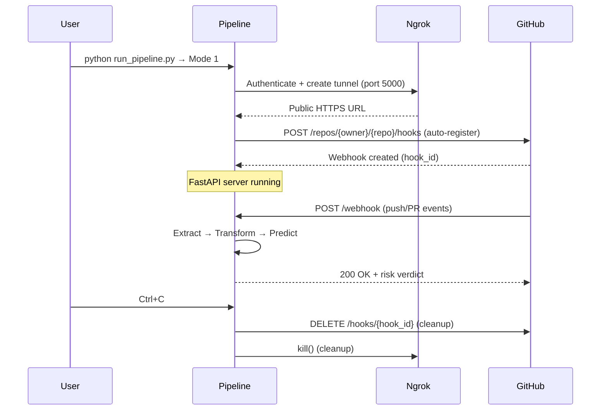

# AI-Powered CI/CD Failure Predictor — Module I
## Pre-Build Commit Metadata Risk Gatekeeper

> **A production-grade MLOps pipeline that predicts build failure risk from commit metadata before CI/CD execution begins.**

---

## 🎯 Overview

**Module I (Metadata Risk Gatekeeper)** is the first component of an AI-Powered CI/CD Failure Predictor system. It analyzes commit metadata—git diffs, historical build logs, PR activity, and repository characteristics—to compute a calibrated failure probability *before* any build runner is provisioned.

This enables **pre-build gating decisions**: fast-track safe commits, flag risky ones for review, or block dangerous changes from consuming expensive CI resources.

---

## 🏗️ Architectural Specifications

| Specification | Detail |
|---------------|--------|
| **Model** | Calibrated LightGBM (1,000 trees, max depth 12, 127 leaves) |
| **Calibration** | Platt Scaling (Sigmoid) — preserves ROC-AUC, improves Brier Score |
| **Features** | 38 engineered metadata features (strict column order) |
| **Explainability** | TreeSHAP (per-commit top-3 risk drivers) |
| **Training Data** | 919,833 deduplicated TravisTorrent build events (70/15/15 split) |
| **Target** | `y_fail = 1 - target_binary` (1 = FAIL, 0 = PASS) |
| **ROC-AUC** | 0.8579 (calibrated) |
| **PR-AUC** | 0.7449 |
| **Inference Latency** | ~3.4 ms (p95 < 15 ms SLA) |
| **Artifacts** | `calibrated_metadata_model.joblib`, `base_lightgbm_model.joblib`, `shap_explainer.joblib` |

### Feature Importance (Top 10 by Gain)
1. `gh_sloc` — Repository size (SLOC)
2. `gh_repo_age` — Repository age in days
3. `tr_build_number` — Build sequence number
4. `gh_repo_num_commits` — Total commits in history
5. `log_team_size` — log1p(contributor count)
6. `gh_test_lines_per_kloc` — Test density
7. `gh_test_cases_per_kloc` — Test case density
8. `gh_asserts_cases_per_kloc` — Assertion density
9. `git_prev_commit_resolution_status_merge_found` — Previous build existed
10. `gh_num_commits_on_files_touched` — File touch history

---

## 🔬 The 38-Feature Pipeline

### Extraction Sources
| Source | Component | Features Extracted |
|--------|-----------|-------------------|
| **Git Diff** | `git_engine.py` | Churn (src/test), files added/deleted/modified, file type breakdown |
| **Repo History** | `git_engine.py` | Commit count, repo age, merge status, file touch frequency |
| **Static Analysis** | `static_analyzer.py` | SLOC, test lines/cases/asserts per KLOC, language detection |
| **GitHub API** | `github_api.py` | PR status, comments, team size, core member, timestamps |
| **CI Metrics** | `ci_analyzer.py` | Build number, previous build status, build history |

### Scaling Contracts (Enforced in Extraction Layer)
```python
log_team_size           = log1p(gh_team_size)
log_built_commits       = log1p(git_num_all_built_commits)
code_churn_density      = git_diff_src_churn / max(1, total_files_changed)
test_to_src_churn_ratio = git_diff_test_churn / max(1, git_diff_src_churn)
```
*No scaling math is duplicated in the normalizer — the extractor emits features already scaled.*

### Feature Schema (Exact Column Order — 38 Features)
```python
FEATURE_COLUMNS = [
    "gh_is_pr", "gh_lang_java", "gh_lang_python", "gh_lang_ruby",
    "git_prev_commit_resolution_status_merge_found",
    "git_prev_commit_resolution_status_no_previous_build",
    "gh_num_issue_comments", "gh_num_commit_comments", "gh_num_pr_comments",
    "log_team_size", "log_built_commits", "gh_repo_age", "gh_repo_num_commits",
    "tr_build_number", "gh_sloc", "git_diff_src_churn", "git_diff_test_churn",
    "gh_diff_files_added", "gh_diff_files_deleted", "gh_diff_files_modified",
    "gh_diff_tests_added", "gh_diff_tests_deleted", "gh_diff_src_files",
    "gh_diff_doc_files", "gh_diff_other_files", "gh_num_commits_on_files_touched",
    "gh_test_lines_per_kloc", "gh_test_cases_per_kloc", "gh_asserts_cases_per_kloc",
    "gh_by_core_team_member", "total_files_changed", "code_churn_density",
    "test_to_src_churn_ratio", "has_previous_build", "gh_pr_created_at_year",
    "gh_pr_created_at_month", "pr_dayofweek", "git_merged_with_present"
]
```

---

## ⚙️ Operational Modes

### Mode 1 — Webhook Listener (Zero-Click Automation)
**For repositories you own/administer.**



**What happens automatically:**
1. 🔐 Reads `NGROK_AUTHTOKEN` from `.env`
2. 🌐 Creates authenticated ngrok tunnel to `localhost:5000`
3. 🔗 Registers GitHub webhook (`push`, `pull_request` → `/webhook`)
4. 🚀 Starts FastAPI + Uvicorn server
5. 🧹 On shutdown: deletes webhook + kills ngrok tunnel

**Fallback:** If token lacks `admin:repo_hook` permission, prints manual setup instructions.

---

### Mode 2 — Passive Poller (ETag-Cached Radar Loop)
**For external/3rd-party repositories where you cannot install webhooks.**

```python
# Polling loop with ETag caching
while True:
    response = GET /repos/{owner}/{repo}/commits?per_page=1
              Headers: If-None-Match: <stored_etag>
    
    if 304 Not Modified:
        print(".")  # Silent heartbeat
        sleep(interval)
        continue
    
    if new_sha != last_seen_sha:
        extract_features(new_sha)
        predict_risk()
        print_telemetry()
        last_seen_sha = new_sha
    
    sleep(interval)
```

**Rate-limit optimization:**
- `ETag` / `If-None-Match` headers → **304 responses cost 0 rate-limit points**
- `last_seen_sha` tracking → skips extraction when SHA unchanged
- Default 30s interval → ~2,880 checks/day (well within 5,000/hr limit)

**UX:** Silent `.` heartbeats during steady state; full telemetry only on new commits.

---

## 🚀 Setup & Execution

### 1. Install Dependencies
```bash
pip install -r requirements.txt
```

### 2. Configure Credentials (`.env` — **Never Commit This File**)
Create `.env` at repository root:
```env
# GitHub PAT must have 'repo' or 'admin:repo_hook' permissions
GITHUB_TOKEN=ghp_xxxxxxxxxxxxxxxxxxxx
NGROK_AUTHTOKEN=3KulCDm3jYkJrF1n6q9dlSTNWhC_2e3zj3EGroLCj1zfLEYbw
```

> ⚠️ **Security:** The `.gitignore` excludes `.env`. Never hardcode tokens in Python files.

### 3. Run the Pipeline
```bash
python run_pipeline.py
```

**Interactive flow:**
```
======================================================================
  MODULE I - PRE-BUILD COMMIT METADATA RISK PREDICTOR
  AI-Powered CI/CD Failure Predictor | Production Pipeline
======================================================================

[CONFIG] Loaded environment from F:\Capstone\Metadata Pipeline\.env
[INIT] Initializing PredictorService...
[MODEL] Calibrated model loaded: CalibratedClassifierCV
[MODEL] Base LightGBM loaded: LGBMClassifier
[MODEL] SHAP explainer loaded: TreeExplainer
[MODEL] Feature schema validated: 38 features in exact order
[MODEL] Ready for inference (target latency: ~3.4ms)

Enter GitHub Repository URL (e.g., https://github.com/owner/repo or owner/repo): 
  [OK] Parsed: owner=myorg, repo=myrepo

Select Operation Mode:
  [1] Webhook Listener Mode (For Owned Repos - Automated ngrok + Webhook Registration)
  [2] Passive Poller Mode (For External/3rd-Party Repos - ETag-Cached Radar Loop)
Enter choice [1 or 2]: 1

Enter local port for webhook server (default 5000): 

[BASELINE] Run baseline prediction on latest commit now? [y/N]: y
[BASELINE] Found latest commit: abc1234 - Fix login bug
[TELEMETRY] ... full prediction output ...

[MODE 1] Starting automated webhook server with ngrok tunneling...
[NGROK] ✓ Authenticated with ngrok
[NGROK] ✓ Tunnel established: https://abc123.ngrok-free.app
[WEBHOOK] ✓ Successfully registered webhook (ID: 456789)
[WEBHOOK]   Target: https://abc123.ngrok-free.app/webhook
[WEBHOOK]   Events: push, pull_request

[SERVER] Starting Uvicorn on 0.0.0.0:5000...
[SERVER] Press Ctrl+C to stop
```

---

## 📊 Gating Thresholds (Production Calibrated)

| Risk Score | Verdict | Action | Use Case |
|------------|---------|--------|----------|
| **< 0.25** | 🟢 **FAST-TRACK** | Proceed with standard/accelerated build | Low risk — 73% recall, 56% precision |
| **0.25 – 0.50** | 🟡 **STANDARD GATE** | Proceed with monitoring | Moderate risk — 51% recall, 78% precision |
| **0.50 – 0.65** | 🟠 **ALERT** | Flag PR/commit for review | Elevated risk — 47% recall, 81% precision |
| **> 0.65** | 🔴 **PRE-MERGE BLOCK** | Halt expensive runner / isolate build | High risk — 40% recall, 88% precision |

*Thresholds derived from calibrated_sigmoid model on 137,975 test builds.*

### Telemetry Output (Per Commit)
```
======================================================================
[INGEST]  Repo: myorg/myrepo | Branch: feature/login
          Commit: abc1234 (abc1234def5678...)
          Event: PUSH
          Time: 2026-10-19T14:32:11.456789

[EXTRACT] Files touched: 12
          Src churn: 342
          Test churn: 18
          Prev build: Yes

[TRANSFORM] All 38 features validated ✓ | Scaling contracts passed ✓

[INFERENCE] Calibrated Failure Probability: 23.45%
            Raw Score: 0.2345
            Model Latency: 3.421 ms

[SHAP TOP DRIVERS]
  Pushing risk UP:
    + git_diff_src_churn: +0.1823
    + total_files_changed: +0.1247
    + gh_diff_tests_deleted: +0.0891
  Pushing risk DOWN:
    - gh_test_lines_per_kloc: -0.1562
    - gh_by_core_team_member: -0.0984
    - log_built_commits: -0.0731

[VERDICT] 🟢 FAST-TRACK — LOW RISK — Proceed with standard/accelerated build
======================================================================
```

---

## 📁 Project Structure
```
F:\Capstone\Metadata Pipeline\
├── .env                          # Credentials (gitignored)
├── .gitignore                    # Comprehensive ignore rules
├── requirements.txt              # Unified dependencies
├── run_pipeline.py               # 🎯 Main CLI entrypoint
├── README.md                     # This file
│
├── Inference_Engine/             # 🧠 Live inference pipeline
│   ├── __init__.py
│   ├── predictor_service.py      # Model loading, validation, prediction, SHAP
│   ├── state_manager.py          # Polling state + ETag caching
│   └── cli_server.py             # FastAPI + ngrok + webhook automation
│
├── Metadata_Extractor/           # 🔧 Feature extraction (package)
│   ├── __init__.py
│   ├── main.py                   # CLI: extract features → CSV
│   ├── core/
│   │   ├── __init__.py
│   │   ├── git_engine.py         # Git diff churn, repo metrics
│   │   ├── github_api.py         # GitHub REST API (PR, commits, contributors)
│   │   ├── ci_analyzer.py        # CI build history via gh CLI
│   │   └── static_analyzer.py    # SLOC, test density, language detection
│   └── schema/
│       ├── __init__.py
│       ├── columns.py            # 40-column schema (38 features + target)
│       └── normalizer.py         # Default fallbacks, type coercion
│
└── Metadata Model/               # 📦 Trained artifacts
    └── Models/
        └── run_20260926_013515/
            ├── calibrated_metadata_model.joblib
            ├── base_lightgbm_model.joblib
            ├── shap_explainer.joblib
            ├── scorecard.json
            └── threshold_matrix_full.json
```

---

## 🔧 Development & Testing

### Run Production Validation (Gate Suite)
```bash
cd "Metadata Model/Metadata Model Gen"
python test_model_production.py
```
Validates: artifact integrity, behavioral invariants, SHAP explainability, latency SLA.

### Extract Features Manually (Metadata_Extractor CLI)
```bash
python -m Metadata_Extractor.main \
  --repo https://github.com/owner/repo \
  --branch main \
  -n 5 \
  --output features.csv
```

### Test Predictor in Isolation
```python
from Inference_Engine.predictor_service import PredictorService, create_feature_dataframe
import numpy as np

predictor = PredictorService()
features = {...}  # 38-feature dict
df = create_feature_dataframe(features)
result = predictor.predict_commit_risk(df)
print(result["failure_probability_pct"], result["verdict"])
```

---

## 📋 Requirements

| Category | Packages |
|----------|----------|
| Core | `requests>=2.28.0`, `pandas>=1.5.0`, `numpy>=1.21.0` |
| ML | `lightgbm>=4.0.0`, `scikit-learn>=1.3.0`, `joblib>=1.3.0`, `shap>=0.42.0` |
| Web | `fastapi>=0.104.0`, `uvicorn>=0.24.0` |
| Config | `python-dotenv>=1.0.0` |
| Automation | `pyngrok>=7.1.0` |

**System:** Git CLI, GitHub CLI (`gh`) authenticated (`gh auth login`)

---

## 🔐 Security Notes

- **No secrets in code** — All credentials via `.env` (gitignored)
- **Webhook signature verification** — HMAC-SHA256 validation on `/webhook`
- **GitHub token scope** — Minimum `repo` or `admin:repo_hook` for webhook registration
- **Ngrok auth token** — Stored in `.env`, never logged in full
- **Temp clones** — Auto-cleaned via `try/finally` in extraction

---

## 📈 Monitoring & Observability

The pipeline emits structured terminal telemetry for every prediction:
- **Ingest metadata** (repo, branch, commit, event type)
- **Extract metrics** (files, churn, build history)
- **Transform validation** (38 features, scaling contracts)
- **Inference results** (probability, latency, raw score)
- **SHAP drivers** (top-3 positive/negative contributors)
- **Verdict** (color-coded gating decision)

For production deployment, integrate with:
- **Prometheus/Grafana** — Export latency, prediction distribution
- **ELK/Logstash** — Structured JSON logging
- **AlertManager** — Page on PRE-MERGE BLOCK verdicts

---

## 📚 References

- **TravisTorrent Dataset** — [travis-torrent.github.io](https://travis-torrent.github.io)
- **LightGBM** — [lightgbm.readthedocs.io](https://lightgbm.readthedocs.io)
- **SHAP TreeExplainer** — [shap.readthedocs.io](https://shap.readthedocs.io/en/latest/tree_explainer.html)
- **GitHub Webhooks API** — [docs.github.com/webhooks](https://docs.github.com/en/webhooks)
- **ngrok** — [ngrok.com](https://ngrok.com)

---

## 🏷️ Version
**Module I — v1.0.0** (2026-10-19)
- Calibrated LightGBM + SHAP
- Automated ngrok + webhook registration
- ETag-cached passive polling
- 38-feature strict schema enforcement

---

*Built with rigor for production CI/CD gatekeeping.*